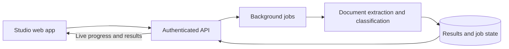

# Acetate Studio

**From financial statements to transactions you can understand.**

Acetate turns PDF and CSV financial statements into structured, categorized transactions. Studio brings that workflow into a single workspace: upload a statement, follow its progress, review the results, and export your data.

The broader goal is to make personal finance easier to explore through both visual interfaces and natural-language questions.

[Explore Acetate Studio](https://studio.acetate.me) · [About the creator](https://github.com/gabrr)

> This repository is a public showcase of an independently developed product. It shares the interface, technology choices, and selected engineering decisions. Application source code and proprietary classification logic remain private.

## The product

Financial statements contain useful information, but turning different document formats into a consistent view of your finances takes work. Acetate combines document processing, AI-assisted extraction, and transaction classification to reduce that manual effort while keeping results available for review.

- **Import statements:** process PDF and CSV files through a shared workflow.
- **Follow processing live:** see progress as a statement moves through extraction and classification.
- **Review transactions:** inspect results, search transactions, and adjust classifications.
- **Organize financial activity:** distinguish fixed expenses, variable spending, installments, and money movements.
- **Export results:** take reviewed transactions into other tools as CSV.

### Statement workspace

### Dashboard direction

The Home view explores how financial summaries can fit into the workspace. Charts shown here are illustrative.

## Engineering highlights

I built Acetate across the product interface, application backend, AI workflow, and cloud infrastructure. Selected areas of work include:

- **Product and frontend engineering:** a domain-oriented React application with reusable components, light and dark themes, and clear separation between interface state, server data, and browser persistence.
- **Applied AI:** document extraction into structured data followed by transaction classification, with confidence information and a reference-dataset evaluation workflow.
- **Asynchronous systems:** durable background jobs, retry handling, saved processing checkpoints, and live progress delivery through Server-Sent Events. Accepted jobs continue when the browser disconnects.
- **State and recovery:** restoring processing progress after a refresh, retaining review edits locally, and preventing duplicate submissions during recovery.
- **Authentication and data access:** Google sign-in through Supabase Auth, backend token verification, and user-scoped access to jobs and results.
- **Quality and observability:** automated checks for financial values, event streaming, and recovery behavior, alongside AI tracing and evaluation.

## Architecture at a glance

Studio is the browser interface; a separate Python service owns statement processing and classification. Background execution separates long-running AI work from the interactive experience.

This overview intentionally stays at the system boundary level. Internal prompts, classification criteria, and detailed workflow implementation are private.

## Selected technology stack

| Area | Technologies |
| --- | --- |
| Web application | Next.js, React, TypeScript |
| Interface and styling | Mantine, Tailwind CSS |
| Client data and persistence | TanStack Query, IndexedDB |
| API and workflow | Python, FastAPI, LangGraph |
| Document processing and AI | Docling, Google Gemini, TypeSafe |
| Authentication and database | Supabase Auth, PostgreSQL, SQLAlchemy, Alembic |
| Cloud infrastructure | Google Cloud Run, Cloud Tasks, Cloud Storage, Docker |
| AI tracing and evaluation | LangSmith |

## Current stage

Acetate is under active development. Statement import, processing, transaction review, and export form the current workflow. Natural-language Q&A is part of the product direction; the conversation agent is not connected in the current Studio experience.

## About

Built by [Gabriel Welzel](https://github.com/gabrr).

Acetate brings together my interests in product design, full-stack engineering, and applied AI. For conversations about the project, engineering roles, or collaboration, visit my [GitHub profile](https://github.com/gabrr).
