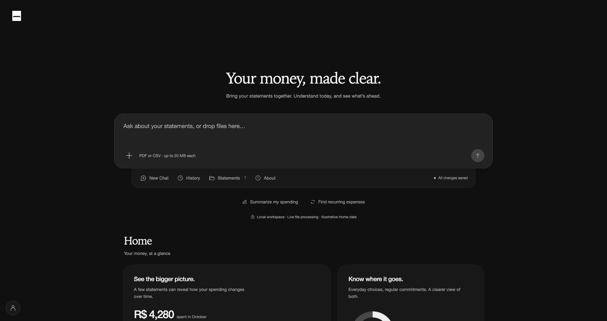
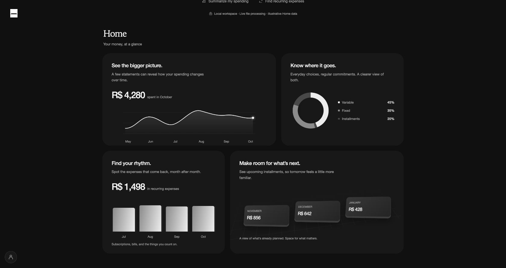
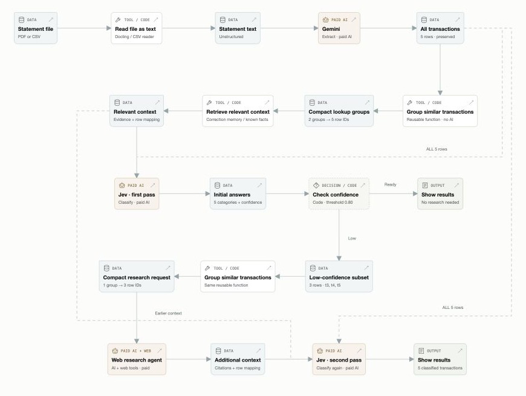

# Acetate Studio

  

**A modern, AI-native personal finance application.**

Upload PDF or CSV statements. Acetate categorizes your transactions so you can explore your finances through visual interfaces and natural language.

[Explore Studio](https://studio.acetate.me) · Author: [Gabriel Welzel](https://gabrr.app)

## The product

Manual categorization takes time. Acetate’s AI workflow achieves **94% accuracy** when categorizing transactions.

- **Import statements:** PDF and CSV.
- **Live progress:** click a file to follow each processing step.
- **Review transactions:** correct uncertain classifications yourself.
- **Financial activity:** fixed, variable, installments, and money movements.
- **Export:** download transactions as CSV.
- **Rich charts:** explore your finances visually. Dashboard previews below use illustrative data.

**Coming next:** learning from your corrections, natural-language Q&A, and food, transport, housing, subscriptions, and custom categories. Later: iMessage, Telegram, and WhatsApp.

### Statement workspace

### Charts · preview

## Engineering highlights

Designed and built across the interface, AI workflow, backend, and cloud infrastructure.

- **Applied AI:** extraction, classification, confidence scoring, and evaluations.
- **Reliable processing:** background jobs, retries, and checkpoints.
- **Live experience:** streamed progress and recovery after refresh.
- **Data access:** authenticated, user-scoped jobs and results.

## Architecture

### Transaction classification

An illustrative flow from statement extraction to classification, including the research path for uncertain transactions. Example data and confidence values are simulated.

*Click the diagram to play the flow, inspect example data, and switch between fitted and enlarged views.*

## Technology

| Layer | Stack |
| --- | --- |
| Interface |  Next.js &nbsp;  React &nbsp;  TypeScript &nbsp;  Mantine &nbsp;  Tailwind CSS |
| Backend & data |  Python &nbsp;  FastAPI &nbsp;  PostgreSQL &nbsp;  Supabase Auth |
| AI |  LangGraph &nbsp;  Gemini &nbsp; TypeSafe &nbsp; Docling &nbsp; LangSmith |
| Infrastructure |  Google Cloud (Run · Tasks · Storage) &nbsp;  Docker |

Public product showcase. Application source code is private.

Built by Gabriel Welzel · [gabrr.app](https://gabrr.app)
